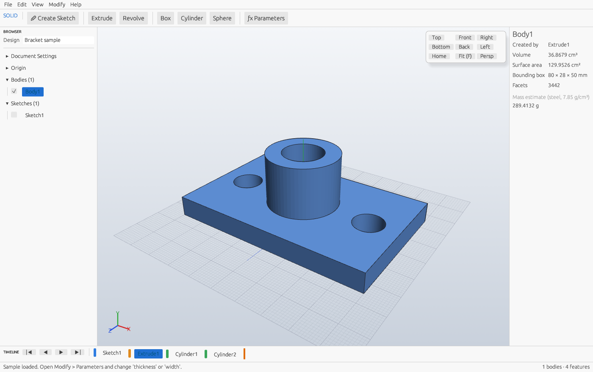
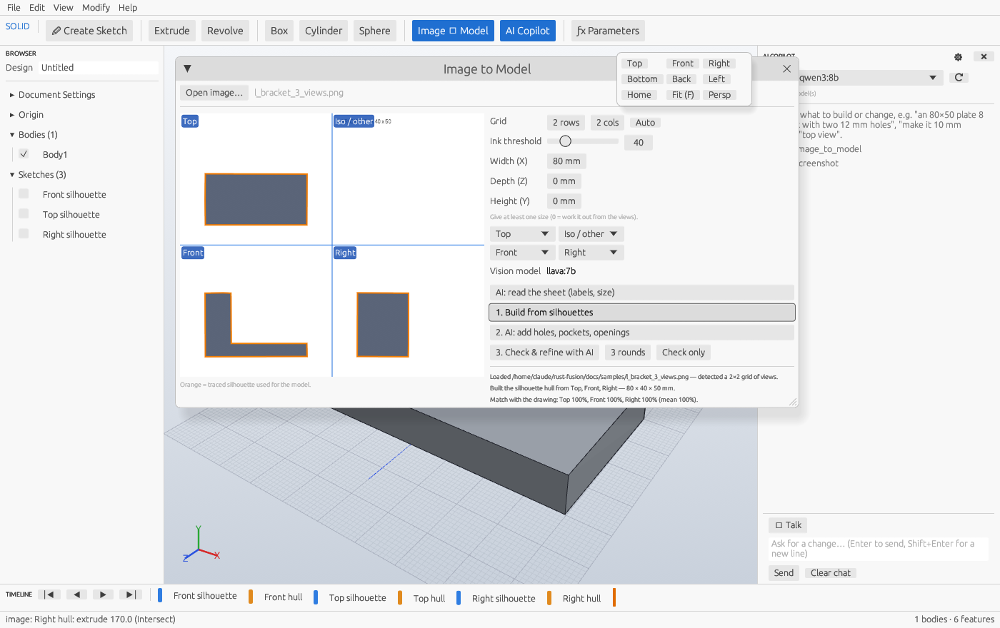

# Rust Fusion

A parametric 3D CAD application written in Rust. You can drive it with the mouse, by typing
plain English, by speaking, or from an outside AI agent over MCP. You sketch on a plane,
extrude or revolve profiles, combine bodies with booleans, and drive everything from named
parameters on a timeline. It can also build models from a sheet of drawing views.

This is an independent project, not affiliated with or endorsed by Autodesk.



## Build and run (Windows, macOS, Linux)

1. Install Rust from <https://rustup.rs> (on Windows, accept the Visual Studio C++ build tools prompt).
2. In this folder:

```
cargo run --release
```

* `cargo run --release -- --sample` starts with a sample bracket; a `.rfz` path opens that file.
* `cargo run --release --no-default-features` builds without voice (faster to compile).
* `cargo test` runs the test suite (kernel, model, app).

The first release build takes several minutes because the Whisper speech model (candle) compiles too.

## Features

| Area | What you get |
|---|---|
| **Modelling** | Sketches on XY / XZ / YZ (with offset), lines, rectangles, circles, snapping, profiles with holes. Extrude, Revolve, Box, Cylinder and Sphere, each as New Body, Join, Cut or Intersect. |
| **Fillet, chamfer, shell** | Round or bevel an extrude's start and/or end cap edges, and hollow an extrude with an open end (toolbar: Fillet, Chamfer, Shell). |
| **Sketch constraints** | Horizontal, vertical, length, angle, parallel, perpendicular, equal, coincident, position and symmetric constraints on polylines, plus Auto-constrain. Lengths and positions take expressions, so a drawn shape becomes parametric. |
| **Parameters & timeline** | Every value is an expression (`width/2 + 3 mm`, `1 in`). From the timeline you can edit, suppress, rename or delete features, and roll back to insert new ones. |
| **AI Copilot** (Ctrl+L or `/`) | Type requests like "an 80×50 plate 8 mm thick with two 12 mm holes" or "make it 10 mm thicker". It uses local **Ollama** or cloud **OpenRouter** models, and each answer is one undo step. Simple requests ("undo", "top view", "set width to 90") run instantly without the AI. If commands fail, the model gets the errors and fixes them (up to 2 rounds). |
| **Voice** (Ctrl+M, `` ` `` or Talk) | Local Whisper speech-to-text (shared model cache with Rust_Blender). Includes hands-free auto-stop, spoken confirmations, conversation mode, an optional wake word ("Fusion, …"), and "stop", "undo that" and "that's all". Spoken numbers ("eighty five millimeters") and common CAD mishearings are fixed. |
| **MCP server** | Claude Desktop, Claude Code, Cursor and similar tools can model in the running app: `get_design`, `run_commands`, `set_parameter`, `screenshot`, `export`, `image_to_model`, `ask_copilot`, `undo`. |
| **Image to Model** | Open a sheet with several views of a part or building (1–9 views). It finds the grid, labels the views (or a vision model reads them), traces each silhouette, and builds the model where the views overlap. A vision model then adds holes and openings. **Check & refine** renders the model from each view, scores the match, and lets the AI correct it; any change that lowers the match is undone. |
| **Building generator** | Storeys, walls, slabs, windows on every facade, a front door, and a gable or flat roof, all driven by parameters (`bldg1_width`, `bldg1_floor_h`, …). There are also `wall` and `opening` commands. |
| **Part library** | Bolts, nuts and washers (M3–M24), an involute spur gear, flange, tube, L-bracket, enclosure and stairs, all parametric. |
| **Files & exchange** | Save/open `.rfz` (JSON). Export STL, glTF (.glb) and STEP (AP214, faceted B-rep). **File > Send to Rust_Blender** imports the model into a running Rust_Blender over its MCP server. |



## Setting up the AI

* **Local:** install [Ollama](https://ollama.com), then run, for example, `ollama pull qwen3:8b` (builder) and `ollama pull qwen2.5vl:7b` (vision). The app finds installed models and picks sensible defaults.
* **Cloud:** open Copilot ⚙ and paste an [OpenRouter key](https://openrouter.ai/keys) (or set `OPENROUTER_API_KEY`). Click **Browse OpenRouter models…** and pick a **Builder** and a **Vision** model.
* **Shared with Rust_Blender:** on first run, the Ollama host, models, OpenRouter key and Whisper model are copied from Rust_Blender's settings. **Import Rust_Blender settings** in Copilot ⚙ copies them again.

Settings are stored in `%APPDATA%\rust_fusion\settings.json` (Windows).

## Using it from Claude (MCP)

Copilot ⚙ ▸ MCP server shows a ready-to-paste config, for example:

```json
{ "mcpServers": { "rust-fusion": { "command": "C:\\Users\\you\\Rust Fusion\\target\\release\\rust-fusion.exe", "args": ["--mcp-stdio", "--port", "7979"] } } }
```

The app listens only on `http://127.0.0.1:7979/mcp`. The `--mcp-stdio` shim forwards to it and starts the app if it isn't running.

## Controls

| Input | Action |
|---|---|
| Left or right drag | Orbit |
| Middle drag, Shift + left drag | Pan |
| Wheel / pinch | Zoom at cursor |
| `S` / `E` | Create sketch / Extrude |
| `L` `R` `C` | Line / Rectangle / Circle (in a sketch) |
| Click the start point | Close a polyline into a profile |
| Double-click, right-click, Enter | End an open polyline |
| `Esc` | Cancel / Select tool / Finish sketch |
| `F` | Fit all |
| Ctrl+L or `/` | Focus the AI copilot |
| Ctrl+M or `` ` `` | Talk |
| Ctrl+Z / Ctrl+Y, Ctrl+S / Ctrl+O | Undo / Redo, Save / Open |

## Architecture

```
crates/
  kernel/  cad-kernel   polygon solids + BSP booleans, extrude / revolve / fillet & chamfer
                        sweeps, region offsets, expressions, feature edges, STL
  model/   cad-model    document, timeline regeneration, sketch constraints + solver,
                        the JSON command set (shared by copilot, voice and MCP),
                        building and part generators
  app/     rust-fusion  egui + wgpu UI, camera/picking, copilot (Ollama/OpenRouter),
                        voice (cpal + candle Whisper), MCP server, image-to-model,
                        glTF/STEP export
```

The AI never edits the document directly. It produces `Command`s, which `Executor::apply`
validates and applies. Commands from the AI, voice, MCP and the generators all go through
the same undoable, logged path.

## Limitations

* The geometry is a mesh kernel (BSP CSG), not an exact B-rep, so STEP exports are faceted solids.
* Fillet and chamfer work on an extrude's cap edges (top/bottom loops). Shell works on extrudes.
* Constraints apply to polylines; rectangles and circles are dimensioned by their expression fields.
* Image to Model handles orthographic views. Perspective/iso views are only shown to the AI.

## Roadmap

1. An exact B-rep kernel (e.g. `truck`) for arbitrary-edge fillets and true STEP surfaces.
2. Sketching on faces, arcs and splines in sketches.
3. Patterns and mirror, measuring, section views.
4. Assemblies with joints; 2D drawings.
